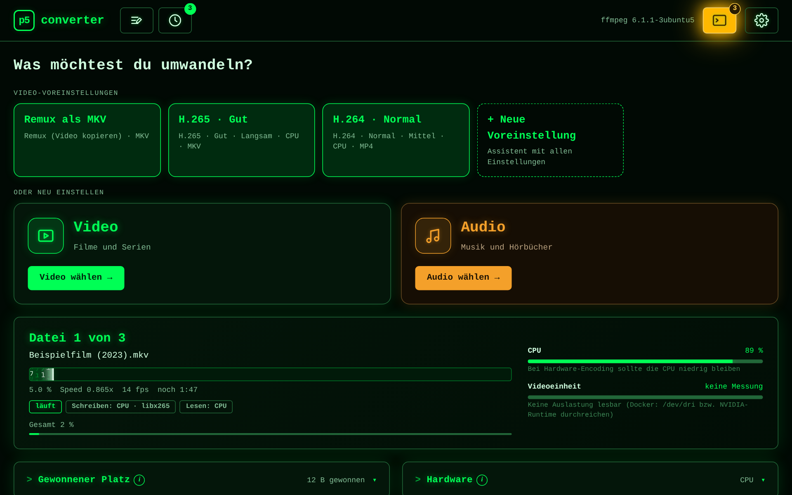
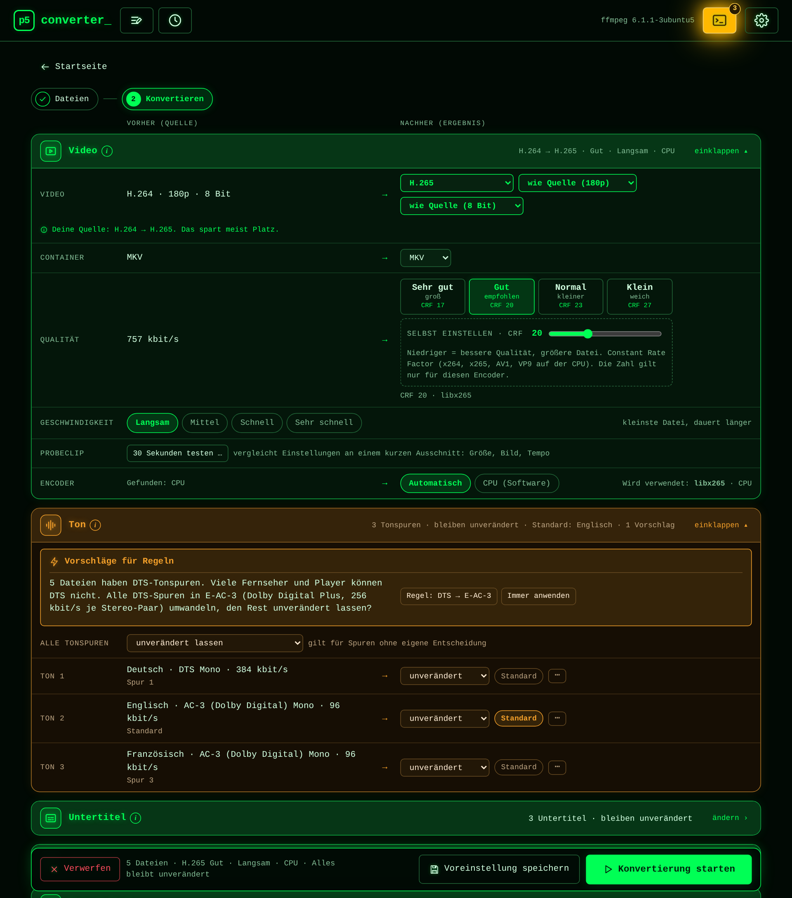
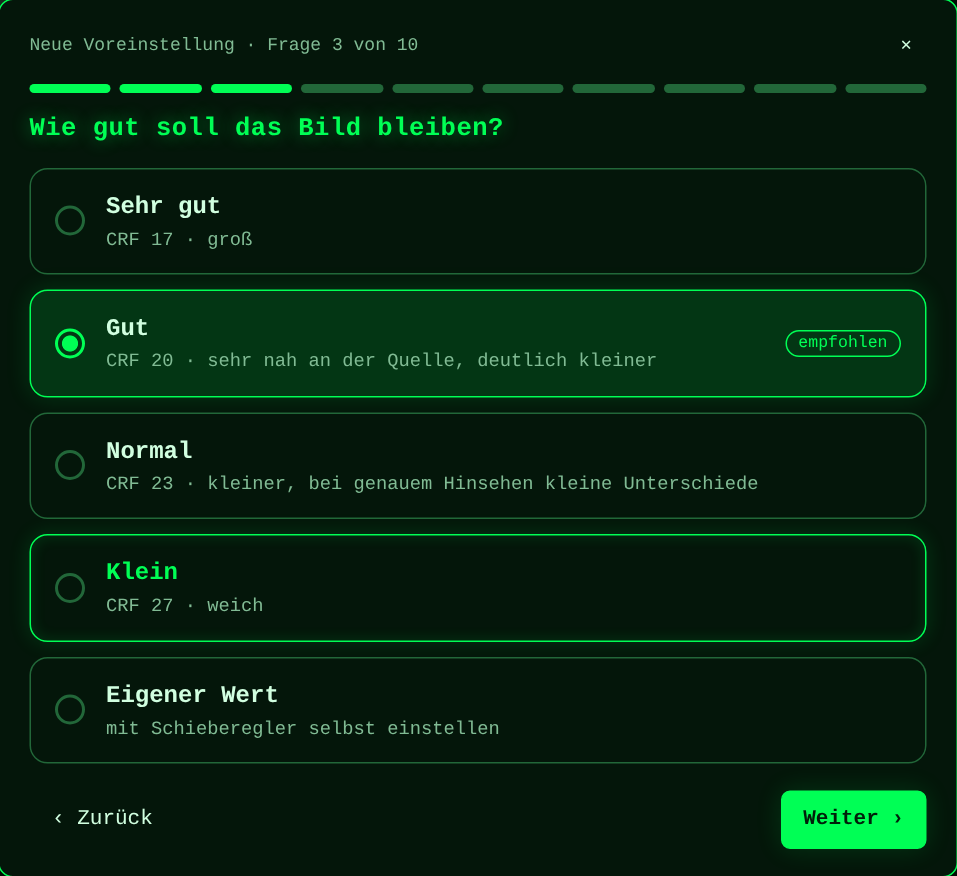
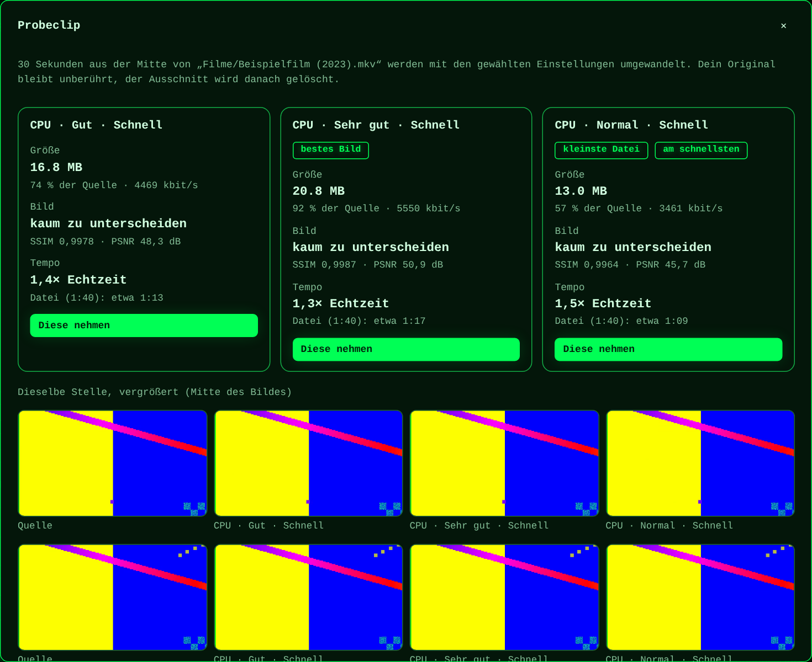
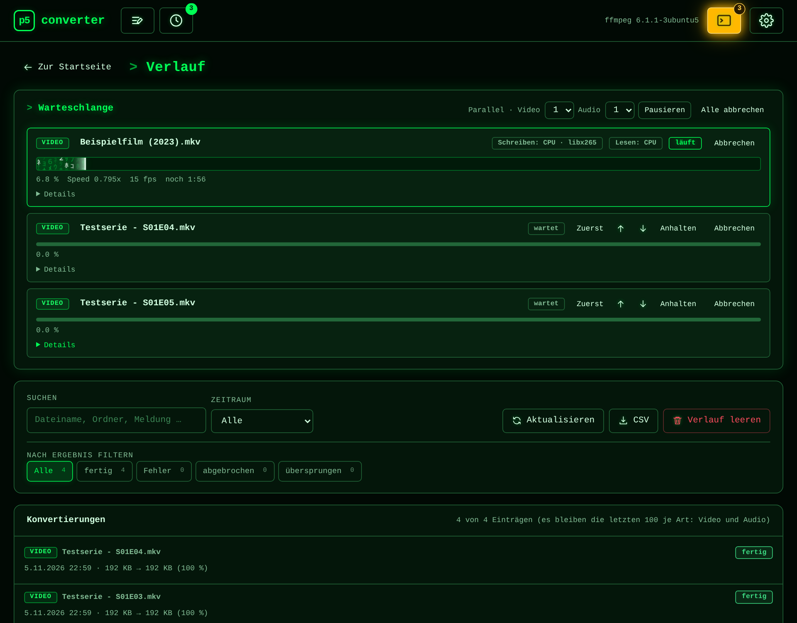
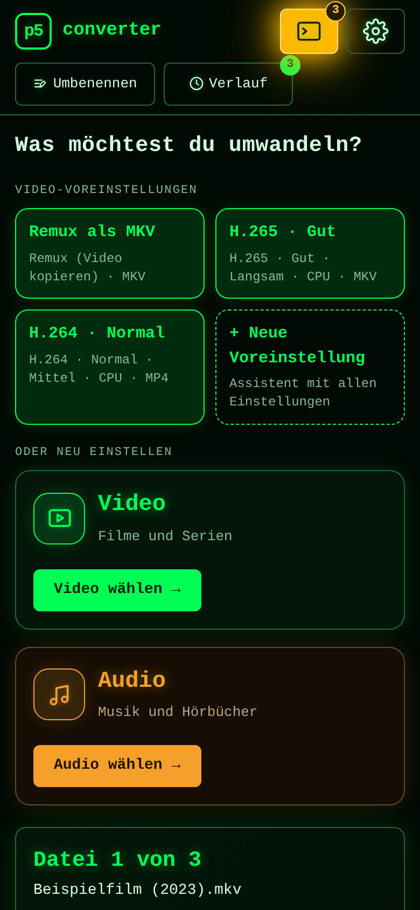

<div align="center">


# p5converter

**Audio und Video umwandeln, mit Hardware-Beschleunigung, Prüfung nach dem Umwandeln und einer Web-Oberfläche im Matrix-Look.**

Ein einzelnes Go-Programm steuert **ffmpeg** an. Es läuft als Docker-Container (zum Beispiel auf **Unraid**) und als **Windows-App**.
Gedacht für ganze Serien-Staffeln, Plex und alle, die ihre Mediathek kleiner machen wollen, ohne etwas zu verlieren.




<sub>Alle Dateinamen in den Bildern gehören zu Testdateien.</sub>

</div>

> **In English:** p5converter is a self-hosted web app (one Go binary plus ffmpeg) for converting audio and video. It runs as a Docker image
> (`ghcr.io/p5lukas/p5converter:latest`, default port 8787) and as a Windows app. Video takes two steps: pick files, then check and start.
> Hardware encoding works with Intel Quick Sync, NVIDIA NVENC, AMD AMF and VAAPI. You can set per-track rules for whole seasons
> (for example DTS to E-AC-3, keep only German and English, detect forced subtitles), try your settings on a 30-second test clip,
> and let the app check every new file before an original is touched. It also has a queue that survives restarts, a folder scan that
> estimates where converting pays off, a history, batch renaming and presets. The interface is in German.

## Was p5converter kann

* **Zwei Schritte für Video:** erst die Dateien wählen, dann auf einer Seite alles prüfen und starten. Links siehst du, wie die Datei jetzt ist, rechts, was herauskommt. Jede Zeile lässt sich direkt ändern.
* **Hardware-Encoding** mit Intel Quick Sync, NVIDIA NVENC, AMD AMF und VAAPI. Die Hardware wird mit einem echten Test-Encode erkannt, und bei jedem Auftrag siehst du, was ffmpeg tatsächlich benutzt hat. Fehlt eine passende Grafikeinheit, rechnet die CPU.
* **Qualität in vier Stufen** (Sehr gut, Gut, Normal, Klein). Das Programm rechnet jede Stufe für den gewählten Encoder in die passende Zahl um und zeigt sie dazu an. Wer es genau will, stellt den Wert mit einem Regler selbst ein.
* **Probeclip:** 30 Sekunden aus der Mitte mit deinen Einstellungen umwandeln und vergleichen (Größe, Bildähnlichkeit, vergrößerter Ausschnitt), bevor der große Lauf startet.
* **Ton und Untertitel für ganze Staffeln:** Dateien mit gleichem Aufbau bilden eine Gruppe, eine Entscheidung gilt für alle. Dazu Regeln nach Format (zum Beispiel nur DTS in E-AC-3 umwandeln), Sprach-Wünsche und die Erkennung von Forced-Untertiteln.
* **Voreinstellungen für Video** als Kacheln auf der Startseite, angelegt mit einem Assistenten, der alle Einstellungen abfragt.
* **Kontrolle nach dem Umwandeln:** Spuren, Laufzeit, Größe und auf Wunsch ein kompletter Decode-Test, bevor ein Original gelöscht wird. Wird ein neu kodiertes Video nicht kleiner, bleibt das Original erhalten.
* **Platz sparen:** „Ordner untersuchen“ zeigt ordnerweise, wo sich das Umwandeln lohnt, mit grober Ersparnis-Schätzung. Dabei wird nichts verändert.
* **Warteschlange** mit Reihenfolge, Anhalten und Pausieren, die einen Neustart übersteht. Dazu ein Verlauf der letzten 100 Aufträge je Art mit CSV-Export und der gewonnene Speicherplatz.
* **Umbenennen** mit Namensmuster, Suchen und Ersetzen und Live-Vorschau, auch ohne zu konvertieren.
* **Handy und Tablet:** läuft im Browser und als Web-App auf dem Home-Bildschirm (Hoch- und Querformat).

<p align="center"><br><sub>Die Seite „Konvertieren“: Video, Ton, Untertitel, Regeln, Name & Ziel und Prüfen als aufklappbare Karten</sub></p>

<table>
<tr>
<td width="50%"><br><sub>Der Assistent legt neue Voreinstellungen an</sub></td>
<td width="50%"><br><sub>Der Probeclip zeigt vorab, was die Einstellungen bringen</sub></td>
</tr>
<tr>
<td width="50%"><br><sub>Warteschlange und Verlauf</sub></td>
<td width="50%"><br><sub>Auf dem iPhone</sub></td>
</tr>
</table>

## Installation

### Unraid

1. `unraid/p5converter.xml` nach `/boot/config/plugins/dockerMan/templates-user/` kopieren.
2. In Unraid unter **Docker → Container hinzufügen → p5converter** die Pfade prüfen und mit **Apply** starten.
3. Die Oberfläche öffnet sich unter `http://<unraid-ip>:8787`.

### Docker

```bash
docker run -d --name p5converter -p 8787:8787 \
  --device /dev/dri \
  -v /mnt/user/musik:/audio1 -v /mnt/user/filme:/video1 \
  -v /mnt/user/appdata/p5converter/output:/output -v /mnt/user/appdata/p5converter/config:/config \
  ghcr.io/p5lukas/p5converter:latest
```

* `--device /dev/dri` reicht Intel Quick Sync und VAAPI durch. Im Unraid-Template steht der Eintrag „Intel/AMD Grafik“ schon drin.
* `/config` speichert Einstellungen, Voreinstellungen, den Verlauf und die Anmeldung dauerhaft. Ohne diesen Pfad funktioniert alles, wird aber nicht gespeichert, und die Anmeldung lässt sich nicht einschalten.
* Die Oberfläche sieht nur eingehängte Ordner. Das Unraid-Template kennt zweimal Audio (`/audio1`, `/audio2`) und viermal Video (`/video1` bis `/video4`), alle optional, dazu den Zielordner `/output`. Per Kommandozeile geht auch ein einzelnes `/media`. Die Liste steht in `P5_ROOTS`. Die Quellordner brauchen Schreibzugriff, wenn die Ergebnisse neben die Quelle sollen oder Quellen gelöscht werden. `PUID` und `PGID` (Standard 99 und 100) bestimmen den Besitzer neuer Dateien.
* Die Anmeldung ist optional. Du legst sie in der Oberfläche unter **Einstellungen → Anmeldung** an, nicht per Umgebungsvariable. Trotzdem gehört p5converter nicht ins offene Internet.

**Grafikkarte einrichten** (alles optional, ohne Grafikkarte rechnet die CPU):

| Hardware | Was du tun musst |
|---|---|
| Intel Quick Sync | nichts, `--device /dev/dri` reicht (im Unraid-Template schon eingetragen) |
| AMD unter Linux (VAAPI) | nichts, ebenfalls `--device /dev/dri`. AMD AMF gibt es nur unter Windows |
| NVIDIA NVENC | Nvidia-Driver-Plugin (Unraid) oder NVIDIA Container Toolkit installieren und `--runtime=nvidia` bei „Extra Parameters“ ergänzen (Unraid: Erweiterte Ansicht). `NVIDIA_VISIBLE_DEVICES=all` und `NVIDIA_DRIVER_CAPABILITIES=compute,video,utility` sind im Image schon gesetzt |

`--runtime=nvidia` ist absichtlich nicht vorausgefüllt: Ohne NVIDIA-Treiber würde Docker den Container gar nicht starten. Ob die Grafikkarte erkannt wurde, steht unter Einstellungen → Hardware.

Hat dein Unraid-Container noch den Eintrag „Passwort (optional)“ (`P5_PASSWORD`), lösche ihn mit REMOVE. Die Variable wird seit 0.0.3 nicht mehr benutzt.

### Windows (Vorabversion)

Lade `p5converter-setup.exe` aus der [neuesten Vorabversion](https://github.com/p5lukas/p5converter/releases) und starte sie. Der laufende Entwicklungsstand liegt in [`dev-latest`](https://github.com/p5lukas/p5converter/releases/tag/dev-latest). Windows meldet beim ersten Start „Unbekannter Herausgeber“, weil die Datei nicht mit einem Zertifikat signiert ist. Klicke auf **Weitere Informationen → Trotzdem ausführen** und geh den Installer durch.

* Der Installer richtet sich nur für dein Konto ein, braucht keine Administratorrechte und enthält Programm und ffmpeg. Er legt ein Startmenü-Symbol an, Desktop-Symbol und Autostart sind optional.
* Die Oberfläche öffnet in einem eigenen Fenster (Microsoft Edge WebView2, bei Windows 11 und aktuellem Windows 10 schon da, sonst richtet der Installer es ein) und sieht aus wie im Browser.
* Intel Quick Sync, NVIDIA NVENC und AMD AMF werden automatisch erkannt, sobald der aktuelle Grafiktreiber installiert ist. Ist ein NVIDIA-Treiber zu alt, steht unter Einstellungen → Hardware → „Warum?“, welche Version fehlt. Bei zwei Grafikeinheiten (zum Beispiel Intel und NVIDIA) probiert die Erkennung die Adapter durch, damit auch das Lesen mit Quick Sync klappt.
* Das Schließen-Kreuz versteckt nur das Fenster. Laufende Aufträge arbeiten im Infobereich weiter, ein Klick aufs Symbol holt das Fenster zurück. Beenden kannst du über das Symbol oder den Knopf „Beenden“.
* Einstellungen und Logs liegen in `%APPDATA%\p5converter`.

### Kanäle: `:latest` und `:dev`

| Image | Branch | Wofür |
|---|---|---|
| `ghcr.io/p5lukas/p5converter:latest` | `main` | stabil |
| `ghcr.io/p5lukas/p5converter:dev` | `dev` | Neues zuerst testen (in Unraid mit der Vorlage `unraid/p5converter-dev.xml` oder indem du im Container das Image auf `:dev` stellst) |
| `ghcr.io/p5lukas/p5converter:<Version>` | Tag | feste Version |

Neues landet zuerst auf `dev` und geht nach dem Test nach `main`. Der Build läuft als GitHub Action bei jedem Push auf `dev` und `main`. Für Windows hängt die Datei an jedem Release, den aktuellen `dev`-Stand findest du in `dev-latest`.

## So benutzt du es

**Startseite.** Oben stehen deine Video-Voreinstellungen als Kacheln, darunter die großen Kacheln **Video** (grün) und **Audio** (orange). Darunter siehst du den aktuellen Auftrag („Datei 4 von 13“ mit Fortschritt) oder „Gerade nichts los“, die Live-Auslastung, den gewonnenen Platz und die erkannte Hardware. In der Kopfzeile sitzen Umbenennen, Verlauf, Logs und Einstellungen.

**Video in zwei Schritten.**
1. *Dateien:* Wähle Dateien oder ganze Ordner. Die Suche im Datei-Browser durchsucht immer auch die Unterordner. Wer eine Voreinstellung wählt, springt direkt zu Schritt 2. Mit „Ordner untersuchen“ findest du heraus, wo sich das Umwandeln lohnt.
2. *Konvertieren:* Auf aufklappbaren Karten stehen **Video** (Codec, Container, Qualität, Geschwindigkeit, Encoder, Probeclip), **Ton**, **Untertitel**, **Regeln**, **Name & Ziel** und **Prüfen**. Unten sind Zusammenfassung, „Als Voreinstellung speichern“, „Verwerfen“ und Start. „Wie Quelle“ zeigt immer an, was die Quelle hat. Ein Funkel-Zeichen markiert, was das Programm selbst angepasst hat, mit Begründung und „rückgängig“.

**Audio** ist eine einzige Ansicht: MP3, Ogg Vorbis, Opus, AAC/M4A, FLAC und WAV, VBR-Qualität oder feste Bitrate, Samplerate und Kanäle. Tags und Cover bleiben erhalten, Ordner lassen sich rekursiv hinzufügen. Voreinstellungen gibt es nur für Video.

**Name und Ziel.** Das Ergebnis kommt neben die Quelle oder in einen eigenen Ordner, mit Ordnerstruktur ab dem Quellordner oder alles in einen Ordner. Das Namensmuster kennt Variablen wie `{title}`, `{year}`, `{res}`, `{codec}` und `{filename}` (bei Audio `{artist}`, `{album}`, `{track}`). Darunter stehen alle Dateien mit altem und neuem Namen. Existiert die Zieldatei schon, kannst du beide behalten (die neue wird nummeriert), überspringen oder überschreiben.

**Ton und Untertitel.** Standard ist, nichts zu ändern. Das Programm macht Vorschläge, jeder lässt sich abwählen:
* *Regeln nach Format*, zum Beispiel nur DTS in E-AC-3 umwandeln. Die erste passende Regel gewinnt. Allgemeine Regeln legst du einmal unter Einstellungen → Regeln an, im Ablauf lassen sie sich pro Lauf abwählen.
* *Sprach-Wünsche* unter Einstellungen → Audio & Untertitel: welche Sprachen bleiben und welche Spur Standard ist, zum Beispiel „Deutsch Forced“.
* *Forced erkennen:* Ist ein Untertitel viel kleiner als die vollständige Spur derselben Sprache (unter 20 %) oder heißt er „Forced“, „Narrative“ und ähnlich, schlägt das Programm „Als Forced markieren“ vor. Mit dem Wunsch „Deutsch (Forced)“ ist er schon gewählt. Die Größenangaben stehen in MKV-Dateien, die mkvmerge erzeugt hat.
* *Spuren ohne Sprachangabe:* Das Programm liest nur, was in der Datei steht. Ein Werkzeug wie [ULDAS](https://github.com/netplexflix/ULDAS) kann fehlende Sprachen vorher ergänzen (Spracherkennung per Whisper). Aus diesem Projekt wird kein Code verwendet.
* *Plex:* Die Sprache wird als Code aus drei Buchstaben geschrieben. Forced erkennt Plex nur in MKV, und die Untertitelsprache muss zur Tonspur passen. Danach in Plex neu analysieren. Schriftarten-Anhänge bleiben in MKV erhalten.

**Voreinstellungen.** „+ Neue Voreinstellung“ auf der Startseite startet den Assistenten. Er fragt Format, Container, Qualität, Geschwindigkeit, Encoder, Auflösung, Bit-Tiefe, Ton und Untertitel ab. Unter Einstellungen → Voreinstellungen kannst du sie umbenennen, sortieren, duplizieren, löschen, als Kachel ein- oder ausblenden und mit „Bearbeiten“ alle Werte auf einer Seite ändern.

**Warteschlange und Verlauf.** Video und Audio laufen in getrennten Warteschlangen mit eigener Zahl paralleler Aufträge. Grün heißt geklappt, Gelb ein Hinweis oder Ausweichweg, Rot ein Fehler. Abbrechen räumt auf: Die unfertige Datei und neu angelegte leere Ordner werden gelöscht, die Quelle bleibt unberührt. Im Verlauf stehen Ergebnis, Größe vorher und nachher, Dauer und Prüfergebnis, bei Fehlern der ffmpeg-Befehl und das Log zum Kopieren.

**Hilfe.** Hinter fast jeder Einstellung steckt ein kleiner **i**-Punkt mit einer Erklärung in einfachen Worten.

## Hardware-Encoding im Detail

* Die Erkennung probiert für jeden Encoder, Codec und jede Bit-Tiefe einen echten Test-Encode, statt nur nachzusehen, ob ffmpeg den Encoder kennt.
* „Automatisch“ nimmt die schnellste Hardware, die wirklich funktioniert. Ein festgelegter Encoder, der nicht funktioniert, wird abgelehnt und nicht heimlich durch die CPU ersetzt.
* Pro Auftrag steht der von ffmpeg gemeldete Encoder („Schreiben: Quick Sync · hevc_qsv ✓“) und ob das Lesen auf der Hardware oder der CPU lief. Dazu der komplette Befehl und das Log. Die Auslastung kommt von `nvidia-smi` (NVIDIA), aus sysfs (Intel) und von `gpu_busy_percent` (AMD).
* Hardware-Decoding ist optional. Klappt es bei einer Datei nicht, probiert das Programm automatisch weitere Wege, zuletzt die CPU zum Lesen.
* Quick Sync läuft auch auf älteren Intel-Chips (Generation 8 bis 11, zum Beispiel i9-9900). Das Image enthält dafür die Media-SDK-Runtime und oneVPL für Generation 12 und neuer.
* Unter Einstellungen → Hardware stehen Diagnose, `vainfo` und die erkannten Grafikeinheiten, mit „Diagnose kopieren“ für Fehlermeldungen.

Die Qualitätszahl heißt bei der CPU CRF, bei NVIDIA CQ, bei Quick Sync ICQ und bei VAAPI und AMD QP. Die Zahlen sind zwischen den Encodern nicht vergleichbar, deshalb rechnet das Programm die vier Stufen für jeden Encoder um. Die Stufen sind Startwerte und noch nicht auf echter Hardware gemessen. Vergleiche Größe und Bild, am einfachsten mit dem Probeclip, und stell den Wert mit dem Regler nach.

## Logs, Anmeldung, Sicherheit

* **Logs:** Das Terminal-Symbol in der Kopfzeile öffnet die Log-Seite mit Suche, Stufenfilter, Live-Ansicht und Download. Die Datei liegt in `/config/logs/p5converter.log` und rotiert. Passwörter, Cookies und Tokens werden nie geschrieben.
* **Anmeldung:** Benutzername und Passwort legst du im Browser an. Das Passwort wird nur als Hash gespeichert, „Angemeldet bleiben“ gilt 30 Tage. Hast du es vergessen: `docker exec -it p5converter p5converter auth reset`, die Variable `P5_AUTH_RESET=1` oder das Löschen von `/config/auth.json`.
* **Sicherheit:** Schreibende API-Aufrufe verlangen JSON und dieselbe Herkunft (Schutz vor fremden Webseiten), Dateizugriff gibt es nur innerhalb von `P5_ROOTS`, und nach Fehlversuchen bremst die Anmeldung.

## Qualitätssicherung

Die CI führt Unit- und Integrationstests mit echtem ffmpeg aus (alle Software-Encoder, Audioformate, Spuren und Untertitel, Parallelität, Abbruch, Sicherheitsprüfungen). Danach startet sie das gebaute Docker-Image zu einem Smoke-Test mit echten Konvertierungen, bevor es veröffentlicht wird. Unter Windows laufen ein Server-Test, ein Test der Programmoberfläche und ein Test des Installers.

**Noch nicht auf echter Hardware geprüft** sind die GPU-Pfade (Quick Sync, NVENC, VAAPI, AMF) und der Probeclip mit Hardware-Encoder. Schau bei den ersten Läufen in die Details des Auftrags, und melde Probleme gern als [Issue](https://github.com/p5lukas/p5converter/issues).

## Entwicklung

```bash
sh tools/precheck.sh          # Vorprüfung vor jedem Push (gofmt, vet, Windows-Build, JS-Syntax, Tests)
go test ./...                 # braucht ffmpeg im PATH
go build -o p5converter . && P5_NO_BROWSER=1 ./p5converter   # http://127.0.0.1:8787
docker build -f docker/Dockerfile -t p5converter .
```

Umgebungsvariablen: `P5_LISTEN`, `P5_ROOTS`, `P5_JOBS`, `P5_CONFIG`, `P5_AUTH_RESET`, `P5_FFMPEG_DIR`, `P5_NO_BROWSER`, `PUID`, `PGID`.
Die Änderungen jeder Version stehen in der [CHANGELOG.md](CHANGELOG.md). Das App-Icon (Quelle und Erzeugung in `tools/icons/`) hat denselben Aufbau wie bei [p5assets](https://github.com/p5lukas/p5assets): Matrix-Regen, Poster-Rahmen, „p5“. Das Abzeichen unten rechts (silberne Audio-CD und blaue Blu-ray) unterscheidet die beiden Apps.

## Roadmap

1. Unraid und Docker weiter stabilisieren und verfeinern
2. Windows-App mit eigener Oberfläche
3. Linux-Desktop-App (Fedora KDE) mit eigener Oberfläche

## Lizenz

[MIT](LICENSE). ffmpeg wird als eigenes Programm mitgeliefert und steht unter seiner eigenen Lizenz (siehe `windows/ffmpeg-LICENSE.txt`).
