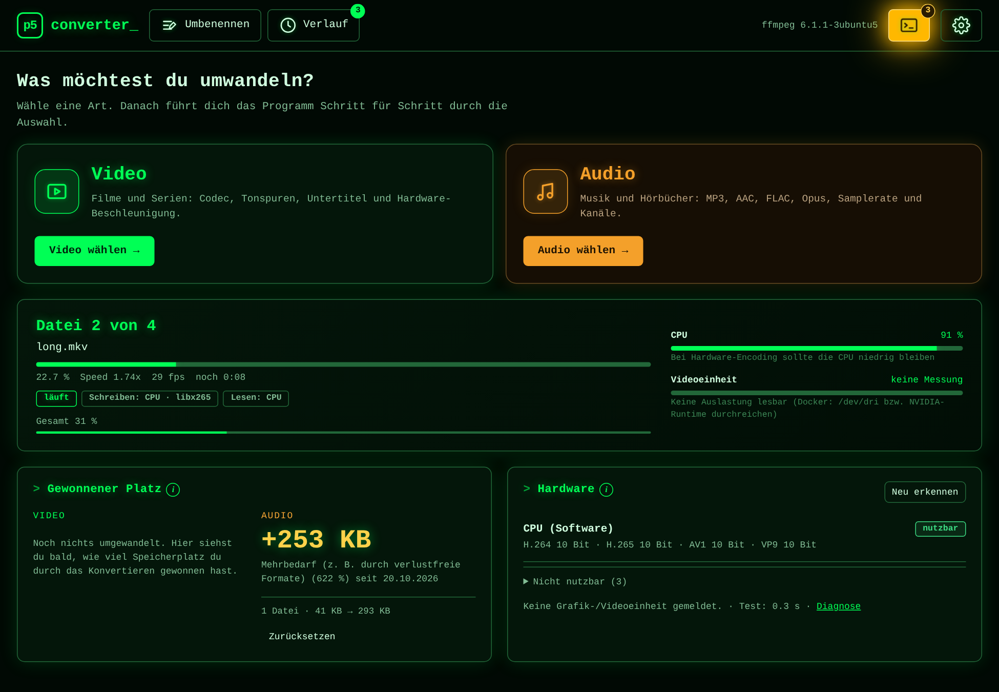
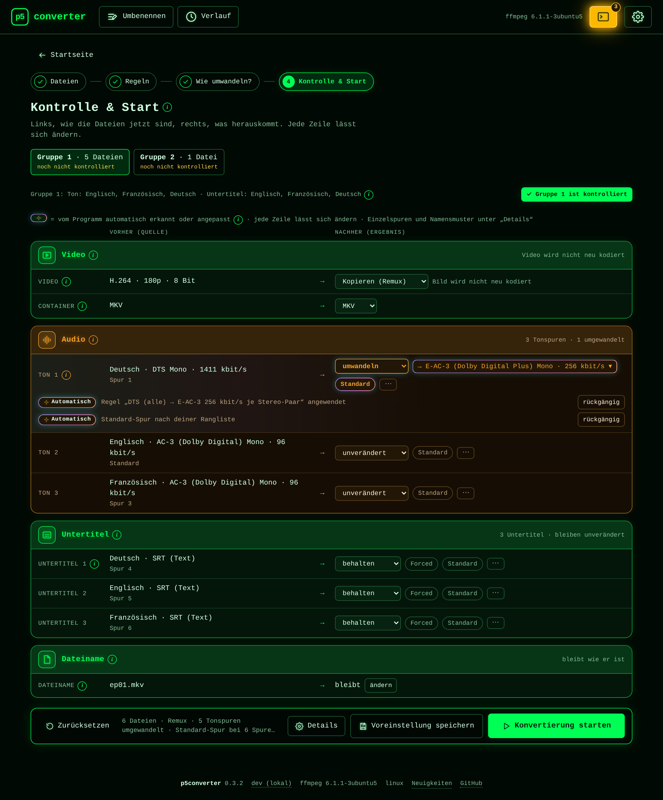
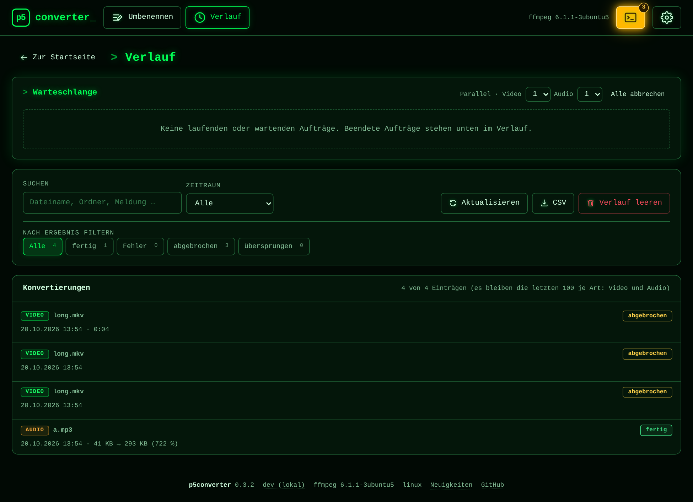
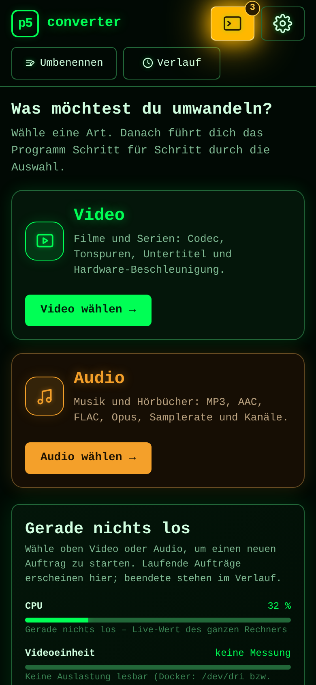

<div align="center">


# p5converter

**Audio und Video konvertieren – mit Hardware-Beschleunigung, Kontrolle nach dem Umwandeln und Web-Oberfläche im Matrix-Look.**

Ein einzelnes Go-Programm steuert **ffmpeg** an. Läuft als Docker-Container auf **Unraid**, als **Windows-App** (Vorabversion) – und später als Linux-App.
Ein SoundConverter-Klon mit zusätzlichem Video-Teil, gebaut für ganze Serien-Staffeln und Plex.




<sub>Alle Dateinamen in den Bildern sind Testdateien.</sub>

</div>

> *English in short:* p5converter is a self-hosted web UI (single Go binary + ffmpeg) to convert audio and video. It supports
> Intel Quick Sync, NVIDIA NVENC, AMD AMF and VAAPI, per-track audio/subtitle rules for whole seasons (e.g. DTS → E-AC-3, keep only German/English,
> forced-subtitle detection), quality in four steps (translated per encoder, with the real number under "Erweitert"), one before/after table instead of wizard steps, a post-conversion check (tracks, length, full decode) before originals are touched, a
> conversion history, renaming, and a Windows app. Docker image: `ghcr.io/p5lukas/p5converter:latest` (stable) or `:dev`, default port 8787.

## Auf einen Blick
* **Startseite mit zwei Kacheln:** Video (grün) oder Audio (orange); Video läuft in **vier Schritten** (Dateien, Regeln, Wie umwandeln?, Kontrolle & Start), dazu Voreinstellungen und Umbenennen mit Live-Vorschau
* **Hardware-Encoding** (Quick Sync, NVENC, AMF, VAAPI) mit sichtbarer Bestätigung, ob Schreiben und Lesen wirklich auf der Hardware laufen
* **Audio & Untertitel für ganze Staffeln:** Gruppen nach Sprachen, Regeln nach Format, Sprach-Wünsche, Forced-Erkennung
* **Kontrolle nach dem Konvertieren:** Spuren, Laufzeit, Größe und auf Wunsch ein kompletter Decode-Test, bevor ein Original gelöscht wird
* **Verlauf** der letzten 100 Aufträge je Art, Video und Audio in einer Liste (mit CSV-Export), **gewonnener Platz**, Live-Auslastung
* **Handy und Tablet:** als Web-App auf dem Home-Bildschirm nutzbar

<p align="center"><br><sub>Kontrolle & Start: die Tabelle „Vorher → Nachher“ in vier Karten (Audio orange), Gruppen, Funkel-Markierung für Automatisches</sub></p>

<table>
<tr>
<td width="50%"><br><sub>Warteschlange und Verlauf</sub></td>
<td width="50%"><br><sub>Mobil / iPhone</sub></td>
</tr>
</table>


## App-Icon
Gleicher Aufbau wie bei **p5assets** (Matrix-Regen, Poster-Rahmen, „p5“); das Abzeichen unten rechts unterscheidet die Apps: bei p5converter **silberne Audio-CD + blaue Blu-ray** (Audio und Video), bei p5assets ein oranger Komet. Dateien: `web/icon*.png`, `web/apple-touch-icon.png` (iPhone/iPad-Web-App), `unraid/icon.png`; Quelle und Erzeugung: `tools/icons/` (`make_icons.py converter <Ordner>`).

## Windows (Vorabversion)
**Eine Datei:** `p5converter-setup.exe` aus der [neuesten Vorabversion](https://github.com/p5lukas/p5converter/releases) (`v0.2.0` usw.; der laufende Entwicklungsstand liegt in [`dev-latest`](https://github.com/p5lukas/p5converter/releases/tag/dev-latest)) laden und starten. Windows meldet beim ersten Start einmal „Unbekannter Herausgeber“ (die Datei ist nicht mit einem Zertifikat signiert): **Weitere Informationen → Trotzdem ausführen**. Danach durchklicken – fertig. Der Installer richtet sich nur für dein Konto ein (keine Administrator-Abfrage), enthält Programm und ffmpeg und legt ein Startmenü-Symbol an (Desktop-Symbol und Autostart optional).
* Die Oberfläche öffnet in einem **eigenen Fenster** (Microsoft Edge WebView2, in Windows 11 und aktuellem Windows 10 schon vorhanden; sonst richtet der Installer es ein) und sieht genauso aus wie im Browser.
* **Hardware wird automatisch erkannt:** Intel Quick Sync, NVIDIA NVENC und AMD AMF (jeweils mit aktuellem Grafiktreiber), sonst rechnet die CPU. Ist ein NVIDIA-Treiber zu alt für NVENC, steht unter Einstellungen → Hardware → „Warum?“ in Klartext, welche Version fehlt – dann den Treiber aktualisieren.
* Einstellungen und Logs liegen in `%APPDATA%\p5converter`.
* **Symbol im Infobereich (Tray):** Das Schließen-Kreuz versteckt nur das Fenster, p5converter und laufende Aufträge laufen weiter. Klick auf das Symbol (oder ein zweiter Start) zeigt das Fenster wieder; **Beenden** über das Symbol oder den Knopf „Beenden“ in der Oberfläche.
* Die Datei hängt an jeder Versions-Vorabversion (`vX.Y.Z` von `main`, `vX.Y.Z-dev` von `dev`); in `dev-latest` liegt immer der aktuelle Stand von `dev`.

## Kanäle: `:latest` und `:dev`
| Image | Branch | Wofür |
|---|---|---|
| `ghcr.io/p5lukas/p5converter:latest` | `main` | stabil |
| `ghcr.io/p5lukas/p5converter:dev` | `dev` | Neues zuerst testen (Unraid vorher mit der Vorlage `unraid/p5converter-dev.xml` oder im Container das Image auf `:dev` stellen) |
| `ghcr.io/p5lukas/p5converter:<Version>` | Tag | feste Version |

Neue Funktionen landen zuerst auf `dev`; nach dem Test geht es nach `main`. Der Build läuft per GitHub Action bei Push auf `dev` bzw. `main`.

## Installation (Unraid)

1. `unraid/p5converter.xml` nach `/boot/config/plugins/dockerMan/templates-user/` kopieren.
2. Unraid → **Docker → Container hinzufügen → p5converter** → Pfade prüfen → **Apply**.
3. Weboberfläche: `http://<unraid-ip>:8787`

Oder per Kommandozeile:
```bash
docker run -d --name p5converter -p 8787:8787 \
  --device /dev/dri \
  -v /mnt/user/musik:/audio1 -v /mnt/user/filme:/video1 \
  -v /mnt/user/appdata/p5converter/output:/output -v /mnt/user/appdata/p5converter/config:/config \
  ghcr.io/p5lukas/p5converter:latest
```
* `--device /dev/dri` reicht Intel Quick Sync / VAAPI durch (im Unraid-Template ein sichtbarer Eintrag „Intel/AMD Grafik“).
* `/config` speichert Einstellungen, Voreinstellungen, Farben und die Anmeldung dauerhaft (gilt auf allen Geräten). Ohne diesen Pfad funktioniert alles, wird aber nicht gespeichert; die Anmeldung lässt sich dann nicht einschalten.
* **GPU einrichten (alles optional, ohne GPU rechnet die CPU):**

  | Hardware | Was du tun musst |
  |---|---|
  | **Intel Quick Sync** | nichts – `--device /dev/dri` (im Unraid-Template schon eingetragen) |
  | **AMD** (unter Linux per VAAPI) | nichts – ebenfalls `--device /dev/dri`; AMD AMF gibt es nur unter Windows |
  | **NVIDIA NVENC** | Nvidia-Driver-Plugin (Unraid) bzw. NVIDIA Container Toolkit installieren und `--runtime=nvidia` bei „Extra Parameters“ ergänzen (Unraid: Erweiterte Ansicht). `NVIDIA_VISIBLE_DEVICES=all` und `NVIDIA_DRIVER_CAPABILITIES=compute,video,utility` sind im Image voreingestellt |

  `--runtime=nvidia` ist bewusst **nicht** vorausgefüllt: Ohne NVIDIA-Treiber würde Docker den Container gar nicht starten. Ob die GPU erkannt wurde, steht unter Einstellungen → Hardware (dort auch ein Hinweis, falls eine GPU fehlt).
* Die Oberfläche sieht nur eingehängte Ordner: im Unraid-Template **2× Audio** (`/audio1`, `/audio2`), **4× Video** (`/video1` … `/video4`) – alle optional, leer lassen was nicht gebraucht wird – und den Zielordner `/output`. Per Kommandozeile geht auch ein einzelnes `/media`. Die Liste steht in `P5_ROOTS`; nicht eingehängte Ordner werden ausgeblendet. Die Quell-Ordner brauchen Schreibzugriff, wenn die Ergebnisse neben die Quelle sollen oder Quellen gelöscht werden. `PUID`/`PGID` (Standard 99/100) bestimmen den Besitzer neuer Dateien.
* Anmeldung (optional): wird in der Oberfläche unter **Einstellungen → Anmeldung** angelegt, nicht per Umgebungsvariable. Trotzdem nicht ins Internet stellen.

## Funktionen

### Design
Gleiche Designlinie wie [p5assets](https://github.com/p5lukas/p5assets): Matrix-Theme mit **einer** Grundfarbe (p5-Grün, nur Audio orange), Startseite mit Kacheln, aktuellem Auftrag und Live-Auslastung, Version und Neuigkeiten in der Fußzeile (nach einem Update einmal pro Version ein kurzer Hinweis, der Merker liegt auf dem Server); in der iPhone/iPad-Web-App Ziehen zum Aktualisieren.
Läuft auf Desktop, Handy und iPad (Hoch-/Querformat); auf iPhone/iPad per **Teilen → Zum Home-Bildschirm** als Web-App.

### Hilfe für Einsteiger
Jede Einstellung hat einen kleinen **ⓘ**-Punkt mit einfacher Erklärung und Beispielen (z. B. wann 10 Bit sinnvoll ist).

### Audio (wie SoundConverter)
MP3, Ogg Vorbis, Opus, AAC/M4A, FLAC, WAV · VBR-Qualität oder konstante Bitrate · Samplerate/Kanäle · Tags und Cover bleiben erhalten · Ordner rekursiv hinzufügen ·
Zielordner mit Struktur oder Namensmuster (`{artist}/{album}/{track} - {title}`) · „Wenn Datei existiert“: beide behalten und die neue nummerieren (`Film (2).mkv`) / überspringen / überschreiben (mit Warnfarbe) · Quelle optional löschen – nur nach bestandener **Kontrolle der neuen Datei** (lesbar und gleich lang; optional Spuren/Größe, kompletter Decode-Test).

### Video
* Container **MKV** (Standard) oder MP4, „Nur Remux“ (Video kopieren)
* Codec **H.264, H.265, AV1, VP9**
* **Auflösung** (max. Höhe, nie hochskaliert), **Qualität in vier Stufen** (Sehr gut, Gut, Normal, Klein; je Encoder in die passende Zahl umgerechnet, mit Anpassung an die Art des Materials: Anime, Korn …; „Erweitert“ zeigt CRF/CQ/ICQ/QP), Geschwindigkeits-Preset, **8/10 Bit** (oder „wie Quelle“)
* **Audio & Untertitel direkt in der Tabelle, auch für Einsteiger und für ganze Serien:** Standard ist **Passthrough** (nichts ändern). Das Programm macht Vorschläge, jeder lässt sich abwählen. **Drei Ansichten:** **Gruppen** (Dateien mit gleichen Sprachen zusammengefasst, Haken je Sprache gilt für die ganze Gruppe, Vorschau „Was passiert“, abweichende Dateien markiert), **Tabelle** (Dateien × Sprachen mit Haken) und **Einzelne Dateien** (Spurkarten in Klartext mit „Erweitert“: Titel, Sprache, **Forced (erzwungene Untertitel)**, Standard, Format). **Regeln nach Format** (z. B. nur DTS in E-AC-3 umwandeln, Bild-Untertitel entfernen; erste passende Regel gewinnt; **allgemeine Regeln** in den Einstellungen auf dem Server, die im Ablauf als voreingestellte Regeln erscheinen und je Lauf abwählbar sind; eigene Regeln als Voreinstellung speicherbar; mit Regel-Vorschlägen) und **Sprach-Wünsche** in den Einstellungen als Rangliste (Ton/Untertitel behalten, Standard-Ton, Standard-Untertitel z. B. „Deutsch Forced“). Die Wirkung steht vor dem Start in der Zusammenfassung
* **Forced erkennen:** Ist ein Untertitel viel kleiner als die vollständige Spur derselben Sprache (unter 20 %), schlägt das Programm „Als Forced markieren“ vor (nie ungefragt; mit dem Wunsch „Deutsch (Forced)“ ist er vorausgewählt). Dafür braucht die MKV die Größenangaben, die mkvmerge ablegt
* **Spuren ohne Sprachangabe:** Das Programm liest nur, was in der Datei steht. Fehlt bei Ton oder Untertitel die Sprache, kann sie ein Werkzeug wie [ULDAS](https://github.com/netplexflix/ULDAS) vorher automatisch ergänzen (erkennt Sprache per Whisper, auch Forced und SDH); p5converter übernimmt dann die erkannten Sprachen. Es wird kein Code daraus verwendet
* **Datei-Browser:** Suchfeld (filtert den Ordner beim Tippen; „Auch in Unterordnern“ durchsucht alles darunter, Umlaute egal) und eigene **Namen für die Quellordner** (Einstellungen → Allgemein)
* **Plex:** Sprache wird als dreibuchstabiger Code geschrieben; „Forced“ erkennt Plex nur in **MKV** (bei MP4 kommt eine Warnung) und die Untertitelsprache muss zur Tonspur passen; danach in Plex neu **analysieren**
* Schriftarten-Anhänge bleiben in MKV erhalten

> **Unraid:** Zeigt dein Container noch „Passwort (optional)“ (`P5_PASSWORD`), mit REMOVE löschen – die Variable wird seit 0.0.3 nicht mehr benutzt; die Anmeldung legst du in den Einstellungen an.

### Einstellungen, Voreinstellungen, Anmeldung
* **Zahnrad** oben rechts (am Handy als Liste mit Gruppen): Allgemein, Voreinstellungen, Hardware, Audio & Untertitel, Regeln, Anmeldung, Info
* **Voreinstellungen** (Audio und Video): Knopf „Als Voreinstellung speichern“ (Diskette) neben „Konvertierung starten“; in den Einstellungen umbenennen, sortieren, duplizieren, löschen, „Vorschlag“ an/aus und „Werte“ zum Bearbeiten
* **Regeln**: allgemeine Regeln für Ton und Untertitel (Codec → umwandeln/entfernen, Bitrate je Stereo-Paar, E-AC-3 höchstens 640 kbit/s), gespeichert in `/config` für alle Geräte
* **Anmeldung** wie bei p5assets: im Browser anlegen, „Angemeldet bleiben (30 Tage)“, Spaßmeldung nach falschem Passwort (abschaltbar), Passwort nur als Hash; vergessen: `docker exec -it p5converter p5converter auth reset`, `P5_AUTH_RESET=1` oder `/config/auth.json` löschen

### Logs
* **Terminal-Symbol** in der Kopfzeile: Log-Seite mit Suche, Stufenfilter, Live-Ansicht, Download und „Leeren“; Zähler für neue Warnungen/Fehler. Datei: `/config/logs/p5converter.log` (rotierend). Passwörter, Cookies und Tokens werden nie geschrieben.

### Konvertieren in einer Ansicht
* **Kopfzeile:** „Konvertieren“, „Umbenennen“ und „Verlauf“ (mit Zähler für laufende und wartende Aufträge) sind in jeder Ansicht erreichbar
* **Startseite:** die Kacheln **Video** und **Audio** („Was möchtest du umwandeln?“), der **aktuelle Auftrag** („Datei 4 von 13“ mit Fortschritt, Geschwindigkeit und Hardware mit grünen Haken) oder „Gerade nichts los“, daneben die Live-Auslastung; oben die Kacheln **Video** und **Audio**; darunter gleich große Kacheln **Gewonnener Platz** (Video und Audio getrennt gezählt, mit „Zurücksetzen“) und **Hardware**.
* **Video in vier Schritten:** **1 Dateien** (zuerst der Quellordner, die Suche geht immer auch in Unterordner; wer eine Voreinstellung wählt, springt direkt zur Kontrolle), **2 Regeln** (voreingestellte Regeln mit Haken und „betrifft N Dateien“, Vorschläge, eigene Regeln), **3 Wie umwandeln?** (drei Kacheln: Hardware, Speichern, Danach prüfen, mit Satz als Zusammenfassung) und **4 Kontrolle & Start**: die Tabelle **„Vorher → Nachher“** in vier Karten (**Video**, **Audio** in Orange, **Untertitel**, **Dateiname**), links die Quelle, rechts das Ergebnis, jede Zeile direkt änderbar; Spuren heißen „E-AC-3 (Dolby Digital Plus) 5.1 · 640 kbit/s“, das Ziel einer umzuwandelnden Spur ist anklickbar. Dateien mit gleichem Aufbau sind eine **Gruppe**; abweichende Gruppen müssen kontrolliert werden, danach übernimmt das Programm deine Entscheidungen bei gleichen Spuren. Das **Funkel-Zeichen** steht nur bei Automatischem – mit Begründung und „rückgängig“. Info-Punkte (i) erklären jeden Bereich. Unten die Startleiste (Zusammenfassung, **Details**, „Als Voreinstellung speichern“, „Zurücksetzen“, Start). **Audio** ist eine einzige Ansicht mit Dateien, Satz und Tabelle. Danach zurück zur Startseite mit der laufenden Warteschlange
* **Qualität in vier festen Stufen** (Sehr gut / Gut / Normal / Klein, je Encoder und Codec in die passende Zahl umgerechnet, Regler unter „Erweitert“); wird ein neu kodiertes Video **nicht kleiner** als die Quelle, schlägt die Kontrolle an und das Original bleibt erhalten; bei schon kleiner Quelle steht vorher ein Hinweis

### Verlauf
* **Kopfzeile → Verlauf:** oben die Warteschlange (laufende und wartende Aufträge von Video und Audio mit Abzeichen, „Parallel“ je Art, „Alle abbrechen“), darunter die letzten **100** beendeten Aufträge je Art (Video und Audio in einer Liste, gespeichert in `/config`, bleibt nach „Fertige entfernen“ und Neustart): Ergebnis, Größe vorher/nachher, Dauer, Prüfergebnis, bei Fehlern ffmpeg-Befehl und Log · Suche, Filter nach Ergebnis und Zeitraum · **CSV-Export** · „Verlauf leeren“

### Warteschlange (auf der Seite „Verlauf“)
* **Video und Audio laufen in getrennten Warteschlangen** mit eigener Anzahl paralleler Aufträge (eine gemeinsame Liste in der Anzeige); Farben: grün = geklappt, gelb = Hinweis/Ausweichweg, rot = Fehler; „Schreiben“/„Lesen“ mit Haken, wenn ffmpeg die Hardware bestätigt hat
* **Abbrechen räumt auf**: unfertige Datei und vom Auftrag neu angelegte leere Ordner werden gelöscht; Reste eines Absturzes beim nächsten Start; die Quelldatei bleibt unberührt
* **Auslastung** von CPU und Grafik/Videoeinheit live (auch im Leerlauf)

### Umbenennen
* **Namensmuster** mit Variablen (`{title}`, `{year}`, `{res}`, `{codec}`, `{bit}`, `{container}`, `{date}`, `{filename}`; Audio: `{artist}`, `{album}`, `{track}` …) und **Suchen & Ersetzen** (mehrere Regeln, einfacher Text, Groß-/Kleinschreibung egal) im Bereich „Ziel“, mit Live-Vorschau; beides lässt sich in Voreinstellungen speichern
* **Seite „Umbenennen“** (Kopfzeile): Dateien ohne Konvertierung umbenennen, mit Vorschau; es wird nie überschrieben oder verschoben

### Hardware-Encoding
* **Erkennung per echtem Test-Encode** (Quick Sync, NVENC, VAAPI, AMF – je Codec und 8/10 Bit), nicht nur „Encoder im ffmpeg vorhanden“
* „Automatisch“ oder festes Backend; ein nicht funktionierendes Backend wird **abgelehnt, nicht still durch die CPU ersetzt**
* **Nachweis der Nutzung:** pro Auftrag der von ffmpeg gemeldete Encoder („Schreiben: Quick Sync · hevc_qsv ✓“, dazu „Lesen: Hardware/CPU“), kompletter Befehl und Log; live CPU- und GPU-Auslastung (NVIDIA: `nvidia-smi` mit Encode/Decode-Engine · Intel: Status „Quick Sync: Leerlauf/aktiv“ aus sysfs-RC6 · AMD: `gpu_busy_percent`)
* Hardware-Decoding optional (bei Quick Sync, VAAPI und NVIDIA mit durchgängiger Hardware-Kette, daher „Lesen: … ✓“ nachweisbar); bei Fehlern probiert das Programm automatisch weitere Wege, zuletzt die CPU zum Lesen – ohne Fehlermeldung
* **Quick Sync auch auf älteren Intel-Chips** (Gen 8–11, z. B. i9-9900): das Image enthält die Media-SDK-Runtime *und* oneVPL (Gen 12+); die Erkennung probiert mehrere Startvarianten
* **Diagnose** unter Einstellungen → Hardware (Ergebnis jedes Tests, `vainfo`, GPUs) mit „Diagnose kopieren“

> Die Qualitätszahl (CRF bei der CPU, CQ bei NVIDIA, ICQ bei Quick Sync, QP bei VAAPI/AMD) ist zwischen den Encodern nicht vergleichbar; deshalb rechnet das Programm die vier Stufen je Encoder um. Die Stufen sind Startwerte und noch **nicht auf echter Hardware gemessen** – bitte Größe und Bild vergleichen und die Zahl unter „Erweitert“ nachstellen.

## Qualitätssicherung
Die CI führt Unit- und Integrationstests mit echtem ffmpeg aus (alle Software-Encoder, Audioformate, Spuren/Untertitel, Parallel-Kollisionen, Abbruch, Sicherheitsprüfungen) und startet das gebaute Docker-Image zu einem **Smoke-Test mit echten Konvertierungen**, bevor es veröffentlicht wird.
**GPU-Pfade (QSV/NVENC/VAAPI) sind implementiert, aber noch nicht auf echter Hardware geprüft** – bitte erste Läufe über „Details“ am Auftrag kontrollieren und Probleme melden.

## Sicherheit
Optionale Anmeldung (Hash des Passworts, Sitzungs-Cookie, Bremse bei Fehlversuchen). Schreibende API-Aufrufe verlangen JSON und dieselbe Herkunft (Schutz vor fremden Webseiten); Dateizugriff nur innerhalb von `P5_ROOTS`.

## Entwicklung
```bash
sh tools/precheck.sh          # Vorprüfung vor jedem Push (gofmt, vet, Windows-Build, JS-Syntax, Versionsstellen, Tests)
go test ./...                 # benötigt ffmpeg im PATH
go build -o p5converter . && P5_NO_BROWSER=1 ./p5converter   # http://127.0.0.1:8787
docker build -f docker/Dockerfile -t p5converter .
```
Umgebungsvariablen: `P5_LISTEN`, `P5_ROOTS`, `P5_JOBS`, `P5_CONFIG`, `P5_AUTH_RESET`, `P5_FFMPEG_DIR`, `P5_NO_BROWSER`, `PUID`, `PGID`.

## Roadmap
1. Unraid/Docker stabilisieren, Design verfeinern
2. Windows-App mit eigener Oberfläche
3. Linux-Desktop-App (Fedora KDE) mit eigener Oberfläche
